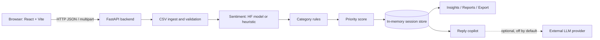

# Revio AI: Customer Review Intelligence Copilot

> **Independent proposed prototype.** Inspired by a publicly described product category (an "AI review assistant"). It is **not** an official Cynbit Technologies feature, uses no Cynbit systems, code or data, and makes no claims about Cynbit's internals. Built as a personal project for an AI/ML Engineer Intern assessment.

Revio AI helps a business analyze customer reviews: it classifies sentiment, groups reviews into issue categories, scores which reviews need attention first, summarizes recurring themes, and drafts replies **for a human to approve**.

## Features

- **CSV import:** drag and drop, sample download, preview before analysis, clear validation errors. Duplicates, blank reviews, missing ratings and invalid dates are counted and reported, never silently dropped.
- **Sentiment analysis:** Positive / Neutral / Negative using an optional pretrained Hugging Face model, with an honestly labeled heuristic fallback that works fully offline.
- **Issue categories:** Product Quality, Delivery, Pricing, Customer Support, User Experience, Refunds and Returns, Other (keyword rules; configurable).
- **Explainable priority score (0-100):** every flagged review shows exactly which factors added points.
- **Insights:** frequent positive/negative keywords with evidence snippets, category counts and trends, recommendations that separate measured counts from generic suggestions.
- **Reply copilot:** Professional / Friendly / Empathetic drafts with Copy and Regenerate. Always labeled as a draft; never sent automatically.
- **Export:** analyzed reviews as CSV, with spreadsheet formula-injection protection.
- **Settings and status:** backend health, active analysis mode, LLM status (no secrets shown), privacy notes, light/dark theme.

## Screenshots

_No screenshots yet. Run the app, take real screenshots, and add them here:_

| Overview | Analyze Reviews | Review Explorer |
|---|---|---|
| `docs/overview.png` (placeholder) | `docs/analyze.png` (placeholder) | `docs/explorer.png` (placeholder) |

## Architecture



## Technology stack

- **Frontend:** React, Vite, TypeScript, Tailwind CSS, React Router, Recharts, Lucide icons, Vitest + Testing Library.
- **Backend:** Python 3.11+, FastAPI, Pydantic, Pandas, NumPy, scikit-learn (evaluation utilities), HTTPX, Pytest.
- **Optional:** Hugging Face Transformers + PyTorch (`cardiffnlp/twitter-roberta-base-sentiment-latest`, labels negative / neutral / positive). Check the model card for its licence and limits; it was trained on tweets, so reviews may differ.
- **Storage:** none. One active dataset is kept in server memory and is lost on restart.

## Project structure

```
revio-ai/
  backend/
    app/            main.py, api/, services/, schemas/, core/
    tests/
    requirements.txt, requirements-ml.txt, .env.example
  frontend/
    src/            components/, pages/, layouts/, hooks/, lib/, types/, test/
    package.json, vite.config.ts, tailwind.config.js, .env.example
  data/             sample_reviews.csv (synthetic)
  reports/          ai_opportunity_report.md, technical_approach.md  (to be added)
  README.md, .gitignore
```

## Quick start

You need **Python 3.11+** and **Node.js 18+**. Run the backend and frontend in two separate terminals, both from the repository root.

### Windows (PowerShell)

Terminal 1, backend:

```powershell
cd backend
python -m venv .venv
.venv\Scripts\Activate.ps1
pip install -r requirements.txt
copy .env.example .env
$env:SENTIMENT_MODE="heuristic"
uvicorn app.main:app --reload --port 8000
```

If activation is blocked, run `Set-ExecutionPolicy -Scope Process Bypass` first. Check `http://localhost:8000/health`.

Terminal 2, frontend:

```powershell
cd frontend
npm install
copy .env.example .env
npm run dev
```

Open `http://localhost:5173`.

### macOS / Linux

```bash
# Terminal 1
cd backend && python3 -m venv .venv && source .venv/bin/activate
pip install -r requirements.txt && cp .env.example .env
SENTIMENT_MODE=heuristic uvicorn app.main:app --reload --port 8000

# Terminal 2
cd frontend && npm install && cp .env.example .env && npm run dev
```

### First run

1. Open `http://localhost:5173`. The top bar should show "Backend online".
2. On Overview, click **Load synthetic demo data**, or go to **Analyze Reviews** and upload a CSV.
3. Explore the Review Explorer, AI Insights and Reports pages.

## Configuration

Nothing needs changing for local use; the defaults work.

**`backend/.env`** (secrets live only here, never in the frontend)

| Variable | Default | Purpose |
|---|---|---|
| `ALLOWED_ORIGINS` | `http://localhost:5173,http://127.0.0.1:5173` | CORS allow-list |
| `MAX_UPLOAD_MB` / `MAX_ROWS` | `5` / `5000` | Upload limits |
| `SENTIMENT_MODE` | `auto` | `heuristic` (offline), `transformer`, or `auto` |
| `SENTIMENT_MODEL` | cardiffnlp roberta | Hugging Face model id |
| `LLM_ENABLED` | `false` | Optional LLM reply drafting |
| `LLM_BASE_URL`, `LLM_MODEL`, `LLM_API_KEY` | empty | OpenAI-compatible provider settings |

**`frontend/.env`**: `VITE_API_BASE_URL=http://localhost:8000`. Never put secrets in `VITE_` variables; they are visible in the browser.

### Using the pretrained model

```bash
pip install -r requirements-ml.txt     # large download; CPU is enough
# then set SENTIMENT_MODE=auto (or transformer)
```

The model downloads once and is cached. If loading or inference fails, the backend falls back to the heuristic and the UI says so.

### Optional LLM replies

Disabled by default and not needed for any core feature. To enable, set `LLM_ENABLED=true`, `LLM_BASE_URL`, `LLM_MODEL` and `LLM_API_KEY` in `backend/.env` and restart. **Review text is then sent to that provider.** Only the review text (truncated), product and category are sent, and the prompt forbids promising refunds, discounts or delivery dates. If the call fails, a template reply is used and the UI explains why.

## CSV format

Required column: `review_text`. Optional: `review_id`, `date` (`YYYY-MM-DD` is safest), `rating` (1-5), `product`, `customer`.

```csv
review_id,date,rating,product,customer,review_text
1,2026-07-03,5,Earbuds,Customer A,"Great sound, very happy."
2,2026-07-05,1,Earbuds,Customer B,"Stopped working in two weeks. I want a refund."
```

Limits: `.csv`, up to 5 MB and 5000 rows (configurable). UTF-8 recommended; common fallback encodings are tried. Blank reviews and exact duplicates are skipped and listed; bad dates and ratings are kept but not used.

`data/sample_reviews.csv` is **synthetic**: written for this prototype, with no real customers or personal data. It deliberately includes a duplicate, a blank review, missing ratings, an invalid date, and safety, refund and urgency wording to exercise validation and priority scoring.

## How the analysis works

- **Sentiment:** pretrained model when available (confidence shown), otherwise a negation-aware word-list heuristic (**no confidence is reported**, because the heuristic has no meaningful probability). The heuristic is a demo fallback, not a pretrained model.
- **Categories:** transparent keyword rules, **not a trained ML model**. The highest keyword-hit count wins; refund keywords count double. Known weakness: multi-topic reviews get a single category.
- **Priority score (0-100):** negative sentiment (40; neutral 10) + low rating (25 / 18 / 8 / 2 / 0 for 1-5 stars) + urgency words (5 each, max 15) + refund or payment words (6 each, max 12) + repeated problem (8) + possible safety wording (20), capped at 100. High >= 70, Medium >= 40. This is a transparent heuristic, **not** a validated or calibrated prediction. Safety keyword matches always flag the review for human review and may include false positives.
- **Replies:** rule-based templates by default. Always a draft for human review, never sent automatically.

## API

| Method | Endpoint | Purpose |
|---|---|---|
| GET | `/health` | Status, sentiment mode, LLM configured flag |
| POST | `/api/reviews/preview` | Validate a CSV and return the first rows and counts |
| POST | `/api/reviews/analyze` | Analyze an uploaded CSV |
| POST | `/api/reviews/analyze-sample` | Analyze the bundled synthetic CSV |
| GET | `/api/sample-csv` | Download the sample CSV |
| GET | `/api/summary` | KPIs and chart data for the active dataset |
| GET | `/api/reviews` | List with `q`, `sentiment`, `category`, `priority`, `min_rating`, `max_rating`, `sort`, `order`, `page`, `page_size` |
| GET | `/api/reviews/{id}` | One review with its explanation |
| POST | `/api/reviews/{id}/reply` | Draft a reply (`tone`, `variant`) |
| GET | `/api/insights` | Themes, evidence, recommendations |
| GET | `/api/reviews/export` | Analyzed CSV download |
| DELETE | `/api/reviews` | Clear the active dataset |

Errors use one shape: `{"error": {"code": "...", "message": "..."}}`. Interactive docs: `http://localhost:8000/docs`.

## Tests

```bash
cd backend && python -m pytest -q      # backend
cd frontend && npm test                # frontend
cd frontend && npm run build           # type-check + production build
```

Last verified in the build environment: backend 25 passed, frontend 10 passed, production build succeeded. Tests are offline and deterministic (heuristic mode). Not verified: the Hugging Face model path, live LLM replies, rendered chart appearance (jsdom has no layout), and any deployment. Re-run the commands above on your machine rather than trusting this line.

## Publish to GitHub

```bash
git init
git add .
git status                      # confirm no .env files are listed
git commit -m "feat: Revio AI backend, frontend, sample data"
git branch -M main
git remote add origin https://github.com/<your-username>/revio-ai.git
git push -u origin main
```

Create the empty repository on GitHub first. `.gitignore` already excludes `.env`, virtual environments, `node_modules` and build output.

## Deployment guide (not yet performed)

A realistic path, untested here:

- **Backend** on a Python host such as Render or Railway. Root directory `backend`; build `pip install -r requirements.txt`; start `uvicorn app.main:app --host 0.0.0.0 --port $PORT`; health check path `/health`. Set `ALLOWED_ORIGINS` to your frontend URL and `SENTIMENT_MODE=heuristic` on small instances. Run a **single worker/instance**, because the dataset lives in memory. Store any `LLM_API_KEY` in the host's secret settings.
- **Frontend** on a static host such as Vercel or Netlify. Root directory `frontend`; build `npm run build`; output `dist`. Set `VITE_API_BASE_URL` to the deployed backend URL **before building** (Vite bakes it in).
- Keep frontend and backend environment variables separate. Do not claim a deployment works until you have opened it and tested upload, analysis and export.

## Privacy

Data stays in the backend's memory and is lost on restart. By default no review text leaves your backend; it is sent to an external provider only if you configure an LLM. Logs record counts, not review text. Exports neutralize spreadsheet formula injection. **No authentication is implemented**, so do not expose this prototype publicly with real customer data.

## Assumptions and limitations

- Single user and single session; no persistence, no accounts.
- Sentiment accuracy on real reviews has **not** been measured. No accuracy, F1, latency or business-impact numbers are claimed. To measure it, label a set of reviews yourself and compute metrics with scikit-learn (an evaluation script is not included yet).
- Category rules and priority weights are hand-chosen baselines, not tuned or validated.
- English-language text only.
- The company context comes only from public homepage text; no private Cynbit information is used.

## Future improvements

SQLite persistence, authentication, labeled evaluation set with measured metrics, multilingual models, trained category classifier, confidence-aware review queues, and an approval workflow for replies.
